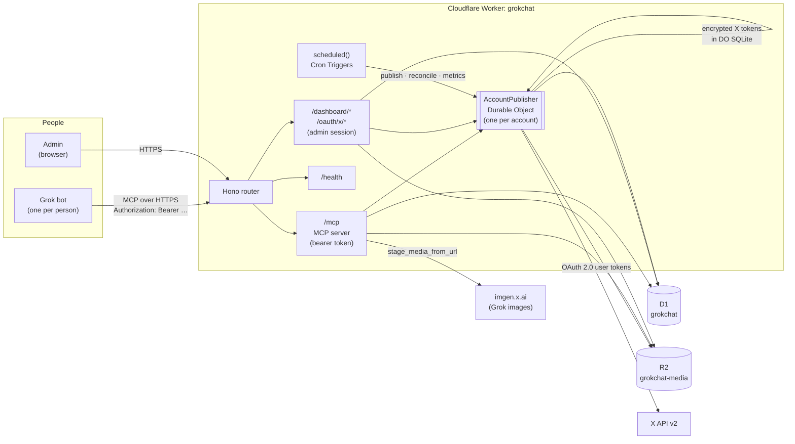
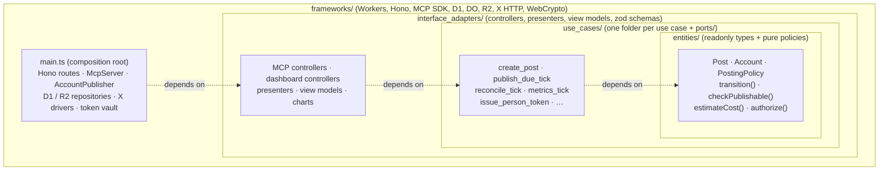
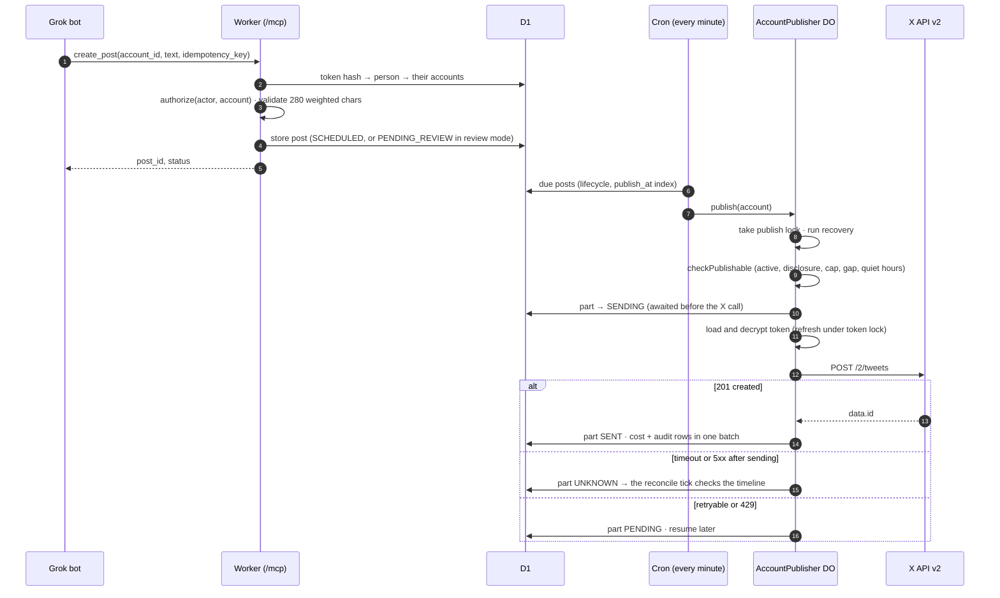
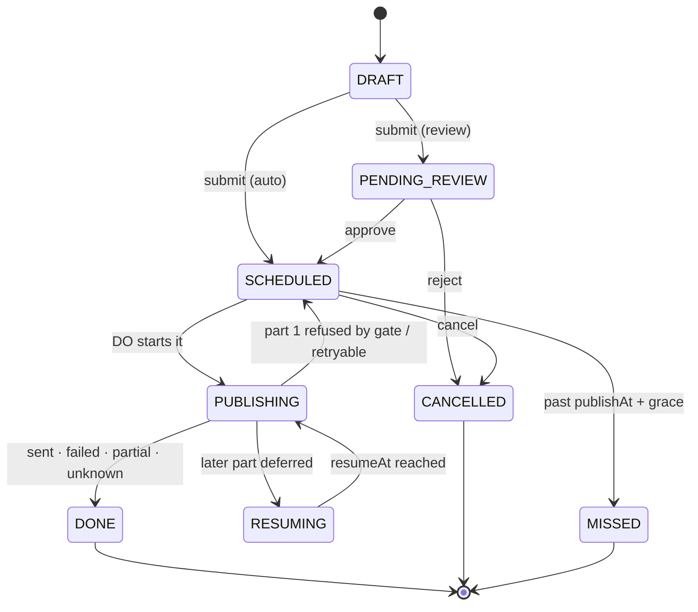
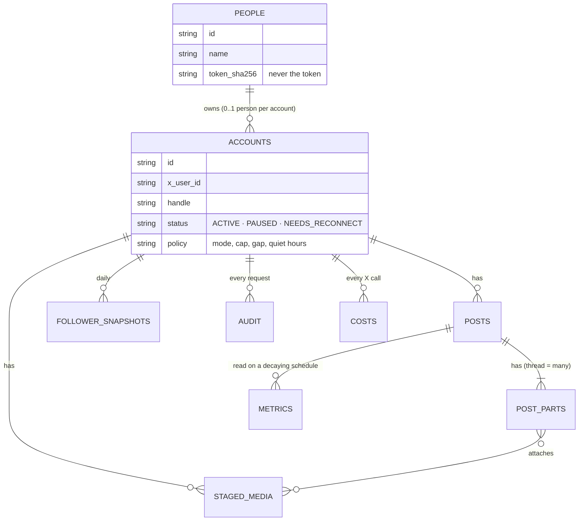
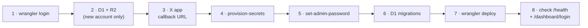
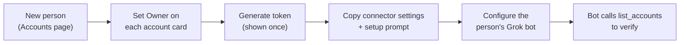

<div align="center">

# GrokChat

**GrokChat is a remote MCP (Model Context Protocol) server, with an admin dashboard, that lets Grok bots publish to X, safely, on Cloudflare's free plan.**

Grok bots connect to the GrokChat MCP server at `/mcp` and call its tools to post. GrokChat schedules, publishes, measures, and keeps a record of every call and what it cost.


[Overview](#overview) •
[Features](#features) •
[Architecture](#architecture) •
[Quick start (local)](#quick-start-local) •
[Deploy to Cloudflare](#deploy-the-mcp-server-to-cloudflare) •
[Dashboard](#run-the-dashboard) •
[Bot tokens](#create-tokens-for-users) •
[MCP tools](#mcp-tools) •
[Development](#development) •
[Docs](#documentation)

</div>

---

## Table of contents

- [Overview](#overview)
- [Features](#features)
- [Architecture](#architecture)
  - [System context](#system-context)
  - [Clean Architecture layers](#clean-architecture-layers)
  - [How a post gets published](#how-a-post-gets-published)
  - [Post lifecycle](#post-lifecycle)
  - [Data and storage](#data-and-storage)
- [Repository layout](#repository-layout)
- [Prerequisites](#prerequisites)
- [Quick start (local)](#quick-start-local)
- [Deploy the MCP server to Cloudflare](#deploy-the-mcp-server-to-cloudflare)
- [Run the dashboard](#run-the-dashboard)
- [Create tokens for users](#create-tokens-for-users)
- [Connect a Grok bot](#connect-a-grok-bot)
- [MCP tools](#mcp-tools)
- [Configuration reference](#configuration-reference)
- [Operations](#operations)
- [Development](#development)
- [Security](#security)
- [Documentation](#documentation)
- [Contributing](#contributing)
- [License](#license)

---

## Overview

GrokChat is an **MCP server**: it exposes 15 tools over the Model Context Protocol (Streamable HTTP, at `https://grokchat.grokchat.workers.dev/mcp`), which a Grok bot adds as a remote connector. It also serves an admin dashboard from the same Cloudflare Worker.

Each person on the team runs a Grok "chief of staff" bot. The bot researches X and writes posts in its own voice. To publish, it calls GrokChat's **MCP server**. GrokChat is the only component that talks to X.

- **Grok owns the voice and the content.** GrokChat stores no personality and generates no content.
- **GrokChat owns posting.** It creates single posts and threads, schedules them, publishes, edits or cancels before publishing, deletes its own posts, reads metrics, and records the cost of every X call.
- **A person owns the accounts.** On the dashboard, an admin connects X accounts, sets each one's posting policy, assigns it to a person, and gives that person one bot token.

It runs entirely on **Cloudflare's free plan**: one Worker, D1, Durable Objects, R2 and Cron Triggers. It uses the official X API v2 only.

## Features

|                             |                                                                                                                                                                      |
| --------------------------- | -------------------------------------------------------------------------------------------------------------------------------------------------------------------- |
| **MCP server for Grok**     | 15 tools at `/mcp`: posts, threads, replies to the account's own posts, images, metrics, policy and backlog                                                          |
| **Exactly-once publishing** | One Durable Object per account serialises every send. A part is marked `SENDING` before the X call, and an unclear outcome goes to reconcile, never to a blind retry |
| **Posting policies**        | Auto-publish or review-first, per account: daily cap, minimum gap, quiet hours, time zone, link policy                                                               |
| **Disclosure gate**         | Publishing is refused until the bio and X's automated-account label are both confirmed on the dashboard                                                              |
| **Images**                  | Grok-generated links (`imgen.x.ai`), files the bot uploads itself in parts, or files uploaded on the dashboard                                                       |
| **Analytics dashboard**     | Impressions, engagements, likes, reposts, replies, link clicks, follower growth and X spend, by account and period                                                   |
| **Audit and cost ledger**   | Every request by a bot, an admin or GrokChat itself, with its X cost                                                                                                 |
| **Free-tier guard rails**   | An R2 quota guard, per-invocation subrequest budgets and indexed queries keep it within Cloudflare's free allowance                                                  |
| **Kill switches**           | Pause one account, cancel or delete one post, rotate or revoke one bot                                                                                               |

---

## Architecture

### System context



| Route                                 | Who                            | Auth                                                                                   |
| ------------------------------------- | ------------------------------ | -------------------------------------------------------------------------------------- |
| `/mcp`, `/mcp/`                       | Grok bots                      | `Authorization: Bearer <person token>` (SHA-256 looked up in D1)                       |
| `/dashboard/*`                        | Admin                          | Signed session cookie, CSRF token and an exact `Origin` check on every non-GET request |
| `/oauth/x/start`, `/oauth/x/callback` | Admin, connecting an X account | Admin session and a signed intent cookie                                               |
| `/health`                             | Anyone                         | None. Returns `{"service":"grokchat","status":"ok","publishing":N}`                    |
| Cron Triggers                         | Cloudflare                     | No HTTP route; `scheduled()` runs directly                                             |

### Clean Architecture layers

GrokChat follows the team's Clean Architecture and SOLID rules (`Agents/CLAUDE.md` §7.1). Dependencies point inward only. dependency-cruiser enforces this and the build fails on a violation.



| Layer                | Folder                                                                                                                            | May import                                                                        |
| -------------------- | --------------------------------------------------------------------------------------------------------------------------------- | --------------------------------------------------------------------------------- |
| Entities             | `src/entities/`                                                                                                                   | Nothing outside the layer                                                         |
| Use cases            | `src/use_cases/` (each with `input_boundary`, `interactor`, `output_boundary`, `output_data`; data-access interfaces in `ports/`) | entities                                                                          |
| Interface adapters   | `src/interface_adapters/` (`mcp/`, `dashboard/`, `cron/`, `health/`, `schemas/`)                                                  | use cases, entities; `zod` only in `schemas/`                                     |
| Frameworks & drivers | `src/frameworks/`                                                                                                                 | anything; the only home of `hono`, `@modelcontextprotocol/sdk` and `cloudflare:*` |
| Composition root     | `src/main.ts`                                                                                                                     | wires concrete classes, exports `fetch`, `scheduled` and the Durable Object class |

### How a post gets published



### Post lifecycle



`DONE` carries a derived status: `PUBLISHED`, `FAILED`, `PARTIALLY_PUBLISHED` or `UNKNOWN_OUTCOME`. The full transition table is in [`docs/PLAN.md`](docs/PLAN.md) §3.1.1, and every row is tested.

### Data and storage



| Store                                       | Holds                                                                                                                                                                                              |
| ------------------------------------------- | -------------------------------------------------------------------------------------------------------------------------------------------------------------------------------------------------- |
| **D1** `grokchat`                           | People and token hashes, accounts, posts and parts, staged-media metadata, metrics, follower snapshots, audit, cost ledger, OAuth state, login throttle. Migrations in [`migrations/`](migrations) |
| **Durable Object SQLite** (one per account) | That account's X token set, encrypted with AES-GCM under `GROKCHAT_TOKEN_KEYS`                                                                                                                     |
| **R2** `grokchat-media` (private)           | Staged images and unfinished bot uploads. Deleted 7 days after their post publishes, or 2 days after staging if never used                                                                         |

---

## Repository layout

```text
src/
  entities/              readonly types and pure functions (no I/O)
  use_cases/<name>/      input_boundary, interactor, output_boundary, output_data
  use_cases/ports/       data-access interfaces, entity types only
  interface_adapters/    MCP and dashboard controllers, presenters, view models, zod schemas
  frameworks/            Workers entry pieces, Durable Object, D1/R2/X drivers, Hono, MCP SDK
  frameworks/composition the production graph's factories
  frameworks/memory      in-memory stubs, one per port (tests only)
  main.ts                composition root
tests/                   architecture, contract, invariants, unit, integration
migrations/              D1 SQL migrations
scripts/                 deploy tooling: provision-secrets, set-admin-password, seed-local, …
docs/                    PLAN.md, runbook.md, decisions/, spikes/
wrangler.jsonc           Worker, bindings, vars and crons
```

## Prerequisites

| Tool               | Version                                                                                                             |
| ------------------ | ------------------------------------------------------------------------------------------------------------------- |
| Node.js            | ≥ 26.10.0 (`engine-strict` is on)                                                                                   |
| npm                | ≥ 11.19.1                                                                                                           |
| Cloudflare account | Free plan is enough. R2 must be enabled                                                                             |
| X developer app    | OAuth 2.0, **confidential client** (Web App). Scopes `tweet.read tweet.write users.read media.write offline.access` |
| Grok               | A Grok setup that accepts a remote MCP connector with a custom `Authorization` header                               |

---

## Quick start (local)

Run the Worker and the dashboard on your machine against a local D1, with seeded demo data. Nothing here touches production.

```sh
git clone https://github.com/Project-Asterion/GrokChat.git
cd GrokChat
npm ci
git config core.hooksPath .githooks
```

1. **Create `.dev.vars`** (gitignored) from the template, with **throwaway values only**, never a production secret:

   ```sh
   cp .dev.vars.example .dev.vars
   ```

   | Name                             | Local value                                                                                            |
   | -------------------------------- | ------------------------------------------------------------------------------------------------------ |
   | `X_CLIENT_ID`, `X_CLIENT_SECRET` | Any dummy string (or a test X app to try OAuth locally)                                                |
   | `GROKCHAT_TOKEN_KEYS`            | A random AES-256 key                                                                                   |
   | `GROKCHAT_SESSION_SECRET`        | At least 32 random characters                                                                          |
   | `GROKCHAT_ADMIN_PASSWORD_HASH`   | `pbkdf2-sha256$100000$<salt>$<hash>` for a local password (format in `src/frameworks/web/password.ts`) |
   | `GROKCHAT_PUBLIC_ORIGIN`         | `http://localhost:8787`                                                                                |
   | `GROKCHAT_MEDIA_HOSTS`           | `imgen.x.ai`, or empty to refuse every media URL                                                       |

2. **Seed the local database.** This applies the migrations to the **local** D1 and fills it with three people, three accounts and about two months of posts, metrics, followers, activity and costs. It is deterministic and never runs against the deployed database.

   ```sh
   npm run seed:local            # add -- --dry-run to print the SQL instead
   ```

3. **Start the Worker.**

   ```sh
   npm run dev                   # wrangler dev, on http://localhost:8787
   ```

4. Open **http://localhost:8787/dashboard/login** and sign in with your local password.

> [!NOTE]
> Move `.dev.vars` out of the clone before `npm run check`. The workerd test plugin also loads it, and its values would override the tests' own.

---

## Deploy the MCP server to Cloudflare

The production Worker is **https://grokchat.grokchat.workers.dev**. The full procedure, with every edge case, is [`docs/runbook.md`](docs/runbook.md). Every script below accepts `--dry-run`, which prints each command with its values masked and runs nothing.



Run every command from the root of a clone of the **release commit on `main`**, after `npm ci`.

### 1. Sign in to Cloudflare

```sh
npx wrangler login
```

### 2. Create the database and the bucket (new Cloudflare account only)

The team's account already has both, and `wrangler.jsonc` names them. On a fresh account:

```sh
npx wrangler d1 create grokchat           # copy the printed database_id into wrangler.jsonc
npx wrangler r2 bucket create grokchat-media
```

If your `workers.dev` subdomain is not `grokchat`, set `GROKCHAT_PUBLIC_ORIGIN` in `wrangler.jsonc` to your Worker's URL, exactly as a browser sends it as `Origin` (no trailing slash).

### 3. Register the callback on the X app

In the X developer portal, add this callback URL to the app, once:

```text
https://grokchat.grokchat.workers.dev/oauth/x/callback
```

Connecting an account fails at X without it.

### 4. Set the Worker secrets

Put the X app's `X_CLIENT_ID` and `X_CLIENT_SECRET` in a dotenv file outside the repo, then:

```sh
npm run provision-secrets -- --env-file <path to the X app's .env> --dry-run   # check first
npm run provision-secrets -- --env-file <path to the X app's .env>
```

This sets each secret the Worker does not have yet, through `wrangler secret put`'s stdin:

| Secret                           | Value                                                                                                |
| -------------------------------- | ---------------------------------------------------------------------------------------------------- |
| `GROKCHAT_TOKEN_KEYS`            | A new AES-256 key, also written to `.token-keys.local` (gitignored, mode 600; you need it to rotate) |
| `GROKCHAT_SESSION_SECRET`        | 32 random bytes                                                                                      |
| `X_CLIENT_ID`, `X_CLIENT_SECRET` | From the env file                                                                                    |

Running it again changes nothing: a secret already set is kept.

### 5. Set the dashboard password

```sh
npm run set-admin-password
```

It asks twice without echo, refuses anything under 12 characters, and stores a PBKDF2-SHA-256 hash as `GROKCHAT_ADMIN_PASSWORD_HASH`. Run it again at any time to change the password.

### 6. Apply the database migrations

```sh
npx wrangler d1 migrations apply grokchat --remote
```

### 7. Deploy

```sh
npx wrangler deploy
```

The output must list three crons: `* * * * *` (publish), `*/10 * * * *` (reconcile) and `*/15 * * * *` (metrics and media cleanup).

### 8. Check it

```sh
curl https://grokchat.grokchat.workers.dev/health
# {"service":"grokchat","status":"ok","publishing":0}
```

Then open `https://grokchat.grokchat.workers.dev/dashboard/login`. A 503 there means a dashboard secret or var is missing or malformed.

> [!IMPORTANT]
> **Deploying a new release later:** a deploy resets every Durable Object, so a send in flight becomes `UNKNOWN` and goes to reconcile. Apply any new migrations first, then deploy only when `/health` shows `"publishing":0`, away from the minute boundary. See [runbook §7](docs/runbook.md#7-deploy-a-new-release) and [§8 (roll back)](docs/runbook.md#8-roll-back).

---

## Run the dashboard

The dashboard is served by the same Worker. There is nothing separate to start.

| Where      | URL                                                                                                  |
| ---------- | ---------------------------------------------------------------------------------------------------- |
| Production | `https://grokchat.grokchat.workers.dev/dashboard/login`                                              |
| Local      | `http://localhost:8787/dashboard/login` (after `npm run dev`, see [Quick start](#quick-start-local)) |

Sign in with the admin password. The pages:

| Page                 | What it is for                                                                                                                                                                                                         |
| -------------------- | ---------------------------------------------------------------------------------------------------------------------------------------------------------------------------------------------------------------------- |
| **Analytics** (home) | Impressions, engagements, likes, reposts, replies, link clicks, follower growth, posts published and X spend for 24 h, 3, 7, 14 or 30 days or all time, against the period before. Every chart has **Show as a table** |
| **Posts**            | Every post with its status and metrics. Approve or reject posts in review, edit, reschedule, cancel, or **Delete on X**                                                                                                |
| **Accounts**         | Connect and reconnect X accounts, confirm disclosure, set the posting policy, pause or resume publishing, manage people and their bot tokens                                                                           |
| **Media**            | Upload images for a bot to use, see each account's media and its `media_id`, delete unused media                                                                                                                       |
| **Activity**         | Every request by bots, admins and GrokChat itself, with its X cost. Filter by account, actor and kind                                                                                                                  |

### Connect an X account

1. **On X, as the account:** the bio says the account is automated and who runs it, and X's automated-account label is on (Settings → Your account → Account information → Automation).
2. **On the dashboard:** **Accounts** → **Connect X account**, sign in on X as the account and authorise the app.
3. The new account starts **PAUSED**. Tick both disclosure boxes and **Save disclosure**. Publishing is refused until both are confirmed.
4. Open **Posting policy**. Start in **Review first**, so every bot post waits on **Posts** for approval. Switch to auto-publish once the bot's posts have been right for a while.
5. Turn on **Publishing on**, and set the card's **Owner** to the person whose bot runs it (next section).

---

## Create tokens for users

Each person gets **one bot token** that covers every account assigned to them. GrokChat stores only the token's SHA-256, never the token.



1. **Add the person.** On **Accounts**, type their name next to **New person** and press it. They get their own section, showing "No token".
2. **Give them their accounts.** On each account's card, set **Owner** to the person. It saves on change. An account belongs to at most one person, and an account with no owner sits under **Unassigned**, where no bot can post to it.
3. **Generate their token.** Press **Generate token** in their section. A page appears **once**, with:
   - the token and a **Copy** button;
   - the Grok connector settings (next section);
   - **Copy setup prompt**: the chief-of-staff prompt with the person's accounts filled in. It never contains the token.

   Leave the page and the token is gone. Reloading it or resubmitting the form never issues a second token.

4. **Configure the person's Grok bot** (next section).

| To…                        | Do this                                                                                                                               |
| -------------------------- | ------------------------------------------------------------------------------------------------------------------------------------- |
| Add an account to a bot    | Connect it, finish its disclosure, set its **Owner**. The token does not change; the bot sees the account on its next `list_accounts` |
| Take an account from a bot | Set its **Owner** to someone else or to **Unassigned**. It applies on the next call                                                   |
| Replace a leaked token     | **Rotate** → **Rotate now** in the person's section. The old token stops working at once; update the bot's connector straight after   |
| Remove a person            | **Delete** (asks for their name). Their accounts become Unassigned and their token stops working                                      |
| Rename a person            | **Rename**. The token is kept; audit rows name the bot by its stable id (`bot:<id>`)                                                  |

## Connect a Grok bot

Add a remote MCP connector to the person's Grok bot with the settings from the token page:

| Setting    | Value                                       |
| ---------- | ------------------------------------------- |
| Name       | `grokchat`                                  |
| Server URL | `https://grokchat.grokchat.workers.dev/mcp` |
| Header     | `Authorization`                             |
| Value      | `Bearer <token>`                            |

Then paste the setup prompt. Its first phase checks the tools, lists the person's accounts with `list_accounts`, and proves that an account id that is not theirs is refused with `scope`.

> [!WARNING]
> A wrong or revoked token fails the **whole** Grok request with "Authentication failed", not just the tool call. Grok follows no redirects and gives each tool call 60 seconds.

---

## MCP tools

Grok shows them as `grokchat___<tool>`. Every refusal is a tool result with `isError: true` and an `error` code, such as `scope` for an account that is not the caller's.

| Tool                   | Kind               | What it does                                                                                                                                                               |
| ---------------------- | ------------------ | -------------------------------------------------------------------------------------------------------------------------------------------------------------------------- |
| `list_accounts`        | read               | The caller's accounts: `account_id`, `handle`, `status`, `mode`, `disclosure_complete`                                                                                     |
| `get_policy`           | read               | An account's status, disclosure and posting policy                                                                                                                         |
| `create_post`          | write              | One post (≤ 280 weighted characters), now or at `publish_at`, with up to 4 photos or 1 GIF. Optional `in_reply_to` for the account's own posts. `idempotency_key` required |
| `create_thread`        | write              | Up to 25 parts, each a reply to the one before                                                                                                                             |
| `edit_post`            | write              | Replace a post's parts or `publish_at` before any part is sent                                                                                                             |
| `cancel_post`          | write              | Cancel a post that has not started publishing (removes nothing from X)                                                                                                     |
| `delete_post`          | write, destructive | Delete a published post from X, last part first                                                                                                                            |
| `stage_media_from_url` | write              | Fetch an image from an allowed host (`imgen.x.ai`) and return a `media_id`                                                                                                 |
| `upload_media`         | write              | Upload an image the bot made, as base64 in hashed parts of ≤ 200,000 characters                                                                                            |
| `list_media`           | read               | An account's staged media, unused by default                                                                                                                               |
| `get_post`             | read               | One post: status, publish time, reply target, each part's text, state and X id                                                                                             |
| `list_backlog`         | read               | The caller's posts, filtered by account, status and publish window                                                                                                         |
| `get_post_metrics`     | read               | Latest metrics of each sent part of a post                                                                                                                                 |
| `get_account_metrics`  | read               | An account's metric totals over a window, with the series behind them                                                                                                      |
| `compare_posts`        | read               | An account's posts in a window, best first by a metric                                                                                                                     |

Replies are allowed **only to posts the same account already published through GrokChat**, because X refuses API replies under other people's posts. Any other target is refused with `reply_target_not_own`.

## Configuration reference

**Secrets** (`wrangler secret put`, set by the scripts):

| Name                             | Purpose                                                         |
| -------------------------------- | --------------------------------------------------------------- |
| `X_CLIENT_ID`, `X_CLIENT_SECRET` | The X app's OAuth 2.0 credentials                               |
| `GROKCHAT_TOKEN_KEYS`            | AES-256 keys for the token vault, comma-separated, newest first |
| `GROKCHAT_SESSION_SECRET`        | HMAC key for the dashboard session cookie                       |
| `GROKCHAT_ADMIN_PASSWORD_HASH`   | PBKDF2-SHA-256 hash of the admin password                       |

**Vars** (`wrangler.jsonc`; a change needs a deploy):

| Name                     | Production value                        | Purpose                                                                                                                                                         |
| ------------------------ | --------------------------------------- | --------------------------------------------------------------------------------------------------------------------------------------------------------------- |
| `GROKCHAT_PUBLIC_ORIGIN` | `https://grokchat.grokchat.workers.dev` | The dashboard's `Origin` check and the OAuth callback base                                                                                                      |
| `GROKCHAT_MEDIA_HOSTS`   | `imgen.x.ai`                            | Hosts `stage_media_from_url` may fetch from, comma-separated, matched exactly. The only SSRF guard, since Workers cannot resolve DNS: list only hosts you trust |

**Bindings:** D1 `DB` (`grokchat`), Durable Object `ACCOUNT` (`AccountPublisher`), R2 `MEDIA` (`grokchat-media`).

## Operations

| Task                                                                         | Where                                                                                   |
| ---------------------------------------------------------------------------- | --------------------------------------------------------------------------------------- |
| Rotate the token-vault keys, session secret, admin password or X credentials | [runbook §4](docs/runbook.md#4-rotate-keys)                                             |
| Kill switch: one account, one post, every bot, everything                    | [runbook §5](docs/runbook.md#5-kill-switch)                                             |
| Read analytics, costs and R2 usage                                           | [runbook §6](docs/runbook.md#6-read-analytics-costs-and-r2-usage)                       |
| Deploy a new release / roll back                                             | [runbook §7](docs/runbook.md#7-deploy-a-new-release), [§8](docs/runbook.md#8-roll-back) |
| Tail production logs                                                         | `npx wrangler tail grokchat --format pretty`                                            |

---

## Development

One command runs every gate. It must be green before every PR:

```sh
npm run check
```

| Step                   | What it checks                                                                                                                        |
| ---------------------- | ------------------------------------------------------------------------------------------------------------------------------------- |
| `npm run typecheck`    | `tsc` strict over three projects (inner layers, Workers, Node tooling)                                                                |
| `npm run lint`         | ESLint, strict type-checked; functions ≤ 40 lines, modules ≤ 400 lines                                                                |
| `npm run format:check` | Prettier                                                                                                                              |
| `npm run depcruise`    | Layers point inward; vendor packages only in `frameworks/`; no cycles or orphans                                                      |
| `npm test`             | Vitest in Node and in workerd with local D1, Durable Object and R2; **≥ 90% line and ≥ 90% branch coverage**, each checked on its own |
| `npm run mutation`     | Stryker on entities, use cases and interface adapters; any surviving mutant fails                                                     |
| `npm run licenses`     | Runtime and dev licences against allowlists                                                                                           |
| `npm run audit`        | `npm audit --omit=dev`                                                                                                                |

While working: `npx vitest run --project unit` (or `architecture`, `workers`), and `npm run mutate:changed` to mutate only the files that differ from `origin/staging`.

**Branches.** `staging` is the default branch and `main` is production:

```text
Plane ticket GROKCHAT-N → feature|fix|chore|hotfix/GROKCHAT-N-slug, cut from staging
  → PR into staging (squash) → tested on staging → release PR staging → main (merge commit)
```

## Security

- **Bot tokens** are 32 random bytes, shown once; only their SHA-256 is stored. Bot auth reads D1 on every request and fails closed (503) if D1 is down.
- **X tokens** are encrypted with AES-GCM in each account's Durable Object; the ciphertext carries its key id, so keys rotate without downtime.
- **Dashboard:** `SameSite=Strict; Secure; HttpOnly` signed session (12 h), a per-session CSRF token and an exact `Origin` check on every non-GET request, a login throttle, and a CSP with no inline script or style.
- **Media fetch:** https only, exact host allowlist, every redirect re-checked, literal IPs refused, size caps and magic-byte checks.
- **Logs** never contain `Authorization`, `Cookie`, or the OAuth `code`/`state`; a test checks this.
- **Secrets** never enter the repo, a command line or a log. Production values are Worker secrets; local values live in the gitignored `.dev.vars`.

Report a vulnerability privately to the repository owners; don't open a public issue.

## Documentation

| Document                             | Contents                                                                                           |
| ------------------------------------ | -------------------------------------------------------------------------------------------------- |
| [`docs/PLAN.md`](docs/PLAN.md)       | The design: verified facts, costs, architecture, transition table, risks and proofs, exit criteria |
| [`docs/runbook.md`](docs/runbook.md) | Deploying and running production, step by step                                                     |
| [`docs/decisions/`](docs/decisions)  | Decision records: TypeScript exception, Cloudflare-only hosting, each dependency                   |
| [`docs/spikes/`](docs/spikes)        | Spike evidence behind the plan (X OAuth, xAI MCP, Cloudflare limits)                               |
| [`CONTRIBUTING.md`](CONTRIBUTING.md) | Setup, gates, where code goes                                                                      |
| [`CHANGELOG.md`](CHANGELOG.md)       | Every notable change and why                                                                       |

## Contributing

Read [`CONTRIBUTING.md`](CONTRIBUTING.md) and the team conventions in `Agents/CLAUDE.md`. In short: one Plane ticket per PR, a branch cut from `staging`, tests in the same PR, a `CHANGELOG.md` entry under `[Unreleased]`, and a green `npm run check`.

## License

Proprietary. Copyright © Project Asterion. All rights reserved. No licence is granted to use, copy or distribute this code.

<div align="right"><a href="#grokchat">Back to top ↑</a></div>
